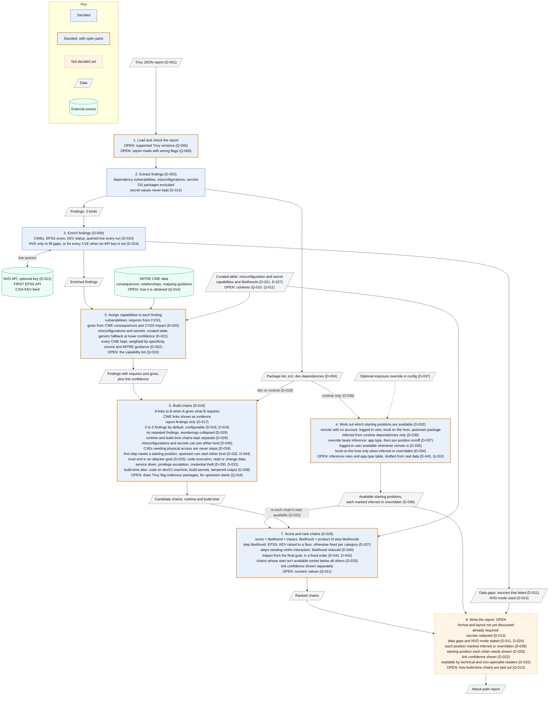

# Internal pipeline

The stages inside open-attack-path, from Trivy JSON in to report out, with the data passed between them. Based on decisions up to D-045. Stage order shows data dependencies only; how the stages are built is not decided.

