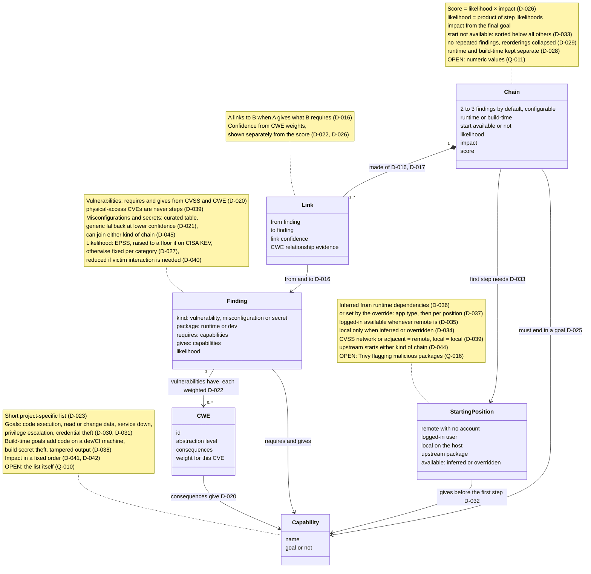

# Chain data model

The things the chain engine works with and how they relate: findings, their weighted CWEs, the capabilities they require and give, the links between findings, the chains made from links, and the starting positions chains begin from. Based on decisions up to D-045.

